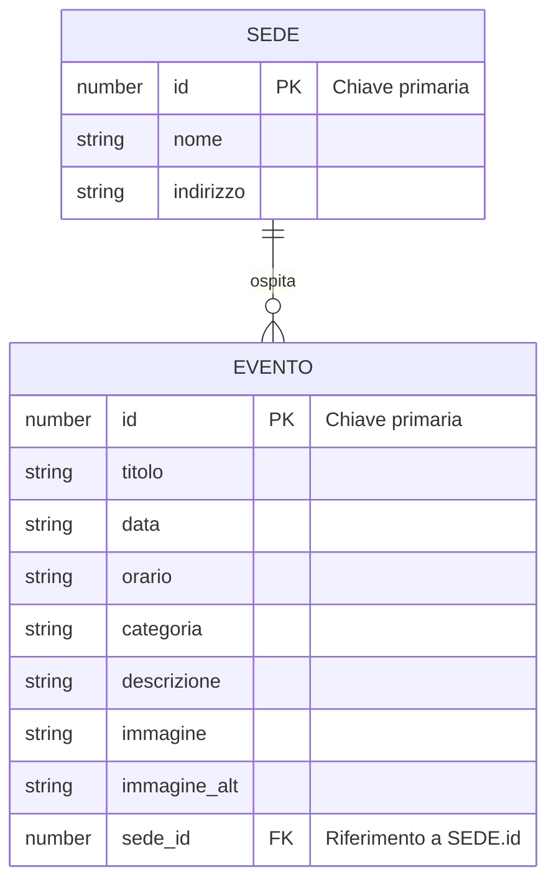

# Scheda dati del festival Segnale

Questa scheda descrive la struttura dei dati del sito, salvati nei file JSON all'interno della cartella `dati/`.

## 1. Entità

Il modello dei dati si basa su due entità principali:
* **Evento** (`dati/eventi.json`): rappresenta i singoli appuntamenti in programma (incontri, laboratori, mostre).
* **Sede** (`dati/sedi.json`): rappresenta gli spazi fisici in cui si svolgono gli appuntamenti.

---

## 2. Campi delle entità

### Entità `Evento` (`dati/eventi.json`)

| Campo | Tipo | Descrizione | Esempio |
| :--- | :--- | :--- | :--- |
| `id` | `number` | Identificativo univoco dell'evento | `1` |
| `titolo` | `string` | Titolo dell'appuntamento | `"Lettere in movimento"` |
| `data` | `string` | Data dell'evento (formato ISO `AAAA-MM-GG`) | `"2026-06-12"` |
| `orario` | `string` | Orario di inizio (formato `HH:MM`) | `"10:00"` |
| `categoria` | `string` | Tipologia di appuntamento | `"Incontro"` |
| `descrizione` | `string` | Breve testo descrittivo dell'evento | `"Come cambia un messaggio..."` |
| `immagine` | `string` | Percorso relativo dell'illustrazione | `"assets/lettere-in-movimento.svg"` |
| `immagine_alt` | `string` | Testo alternativo per l'accessibilità | `"Lettere geometriche disposte su una griglia"` |
| `sede_id` | `number` | Riferimento all'ID della sede ospitante | `1` |

### Entità `Sede` (`dati/sedi.json`)

| Campo | Tipo | Descrizione | Esempio |
| :--- | :--- | :--- | :--- |
| `id` | `number` | Identificativo univoco della sede | `1` |
| `nome` | `string` | Nome immaginario e riferimento reale | `"Officina Nord — Sede centrale"` |
| `indirizzo` | `string` | Indirizzo fisico a Torino | `"Corso Duca degli Abruzzi 24, Torino"` |

---

## 3. Chiave primaria

* **Evento**: il campo `id` (numerico) è la chiave primaria. È univoco all'interno della lista eventi e stabile nel tempo.
* **Sede**: il campo `id` (numerico) è la chiave primaria. È univoco all'interno della lista sedi e stabile nel tempo.

---

## 4. Relazione

* **Cardinalità**: uno-a-molti ($1:N$). Una **Sede** può ospitare più **Eventi**; ogni **Evento** si svolge in una sola **Sede**.
* **Chiave esterna**: il campo `Evento.sede_id` fa riferimento al campo `Sede.id`.

---

## 5. Quantità

* **Eventi**: `6` record totali (3 per venerdì 12 giugno, 3 per sabato 13 giugno).
* **Sedi**: `3` record totali (2 eventi ospitati per ciascuna sede).

---

## 6. Aggiornamento e manutenzione

* **Chi aggiorna**: il team editoriale o gli sviluppatori che gestiscono il progetto didattico.
* **Come**: modificando direttamente i file `dati/eventi.json` e `dati/sedi.json` all'interno della repository (es. su GitHub) ed effettuando un nuovo commit/push per triggerare la pubblicazione automatica del sito statico.

---

## 7. Che cosa mostra la pagina

* **Pagina Programma (`programma.html`)**: legge entrambi i file JSON, incrocia `Evento.sede_id` con `Sede.id` per ricavare il nome del luogo e genera dinamicamente le schede degli appuntamenti (mostrando immagine, data formattata, orario, categoria, titolo, descrizione e nome della sede).
* **Altre pagine (`index.html`, `info.html`)**: utilizzano le informazioni delle sedi per elencare gli spazi, mostrare la galleria fotografica e posizionare i punti sulla mappa.

---

## Schema relazionale (ER)

